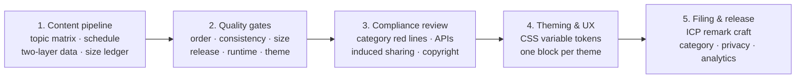

# WeChat Mini Program Content Skill

[](LICENSE)
[](https://www.python.org/)
[](https://developers.weixin.qq.com/miniprogram/en/dev/)

**A field playbook and toolchain for shipping content-focused WeChat Mini Programs under a personal (individual) developer account.**

`wechat-miniprogram-content-skill` is a reusable AI-agent skill plus two standalone gate scripts, distilled from a real shipped project: a 365-card bioinformatics code-card mini program with 10 categories, a daily-card feature, two subpackages, 9 themes, and 16 automated quality gates. It covers the full journey — content pipeline, quality gates, adversarial compliance review, CSS-variable theming, and ICP filing + release.


## Highlights

- **Offline-first by design**: zero `wx.request`, zero `web-view` — one architectural decision that removes most of the compliance surface, at the price of a strictly managed 2 MB package budget.
- **Gates as the specification**: every rule is a runnable script; all gates are re-executed before every delivery, never trusted from history.
- **Compliance treated as adversarial**: the things automated tests cannot catch — category red lines, induced sharing, ICP remark wording — are exactly what gets personal accounts rejected, so they get their own checklist and scanner.
- **Theming as variable overrides**: one `.theme-<id>` block per theme, zero page-code changes per skin, with a gate that prevents "half-applied themes".
- **Original images only**: content figures are produced by the content code itself; atmosphere images are originally generated, watermark-cropped, and manually verified — no scraped web images, ever.

## What it helps you answer

- How do I fit hundreds of content items into a 2 MB main package without breaking over time?
- How do I guarantee hundreds of content entries stay complete, consistent, and correctly routed?
- Why did my mini program pass all tests but still get rejected in review?
- How do I write ICP filing remarks (备案备注) that do not trigger a phone call from the reviewer?
- How do I build multi-theme skinning that stays maintainable instead of "change one thing, break three"?
- What can a personal-account mini program legally do — and what must be designed around on day one?

## Why this is different

- It is **distilled from a shipped project**, not written in the abstract — every rule exists because something actually broke or got rejected.
- It treats **compliance as a first-class engineering stage**, with a scanner and a checklist, instead of a pre-release afterthought.
- It encodes **originality-safe asset pipelines**: no scraped images, no copied icon packs, watermark-cropped generated art.
- It ships **runnable gates**, not just prose: two Python scripts you can wire into CI today.

## Workflow



## Repository contents

| Path | Purpose |
| --- | --- |
| `SKILL.md` | Main agent skill: five-stage workflow, core judgments, script usage, pitfall index |
| `references/methodology.md` | Content pipeline: topic matrix, two-layer data, subpackages, illustration pipeline, template distribution |
| `references/quality-gates.md` | The six-gate system with per-gate criteria + a 12-item real-world pitfall list |
| `references/compliance.md` | Personal-account red lines, scan checklist, ICP remark template (from a real rejection case), release tasks |
| `references/theme-system.md` | Theme-token design, three hard rules, background-image handling, UX differentiation checklist |
| `scripts/check_theme.py` | Theme-token gate: 7 criteria, exit-code driven |
| `scripts/compliance_scan.py` | Compliance first pass: HIGH-RISK vs REVIEW tiers, exit-code driven |
| `assets/` | Diagrams used in this README |

## Quick start

Requirements: Python 3.8+ (no third-party dependencies).

Run the theme-token gate against any mini program that uses `utils/theme.js` + `app.wxss`:

```bash
python scripts/check_theme.py /path/to/miniprogram-source
```

Run the compliance first pass (add content-data directories to scan bundled copy):

```bash
python scripts/compliance_scan.py /path/to/miniprogram-source /path/to/content-data
```

Both scripts exit non-zero on failure, so they drop straight into CI or a pre-commit hook.

## Example use cases

| Situation | Command / action | What you get |
| --- | --- | --- |
| You added a 10th theme and want to be sure nothing is half-wired | `python scripts/check_theme.py <src>` | Missing variables, stale selectors, oversized images — with file-level detail |
| You are about to submit for review | `python scripts/compliance_scan.py <src> <data>` | HIGH-RISK items (must be zero) + REVIEW items with context for human judgment |
| Your ICP filing was rejected over remark wording | read `references/compliance.md` §4 | The four rejection causes and a ready-to-adapt remark template |
| You are designing a second app in the same family | read `references/theme-system.md` §5 | Six deliberate UX differentiation moves to avoid a "reskin" impression |

## Use as an AI-agent skill

Copy this repository into your agent's skills directory (e.g. `~/.workbuddy/skills/`, `~/.claude/skills/`, or a project-level equivalent). The agent will load it when you ask to build, review, re-theme, or publish a content mini program.

Example prompts:

```
Build a 100-card vocabulary mini program for personal release; follow the offline-first shape and set up all quality gates.
```

```
Review my mini program for compliance risks before I submit it — category, induced sharing, privacy, and image copyright.
```

Chinese examples:

```
用这套方法论帮我开发一个个人主体的每日一句小程序，内容 365 条，发布前把门禁都建好。
```

```
我的备案被驳回了，说备注里 Julia 没解释清楚，帮我按模板重写一版备注。
```

## The six quality gates

1. **check_order** — schedule sanity: no duplicates/gaps, spacing, difficulty progression
2. **check_consistency** — index ↔ full-text ↔ routing ↔ images all agree
3. **check_milestone_sum** — package size ledger against the 1950 KB / 2048 KB lines
4. **check_release** — static release checks: syntax, WXML balance, event bindings, asset existence, no webp
5. **runtime_check** — behavioral assertions driving the *real* page code through a mocked `wx`
6. **check_theme** — theme-token integrity (this repo ships a generic version in `scripts/`)



## Scope and disclaimer

- Written for **personal (individual) accounts** shipping content/tool mini programs. Enterprise accounts, payments, and UGC carry different obligations; only the gates and theming sections apply directly.
- The compliance checklist reflects WeChat review and ICP filing practice as of 2026. Platform rules change — always confirm against the latest official documentation before release.
- This project offers engineering guidance; it is not legal advice.

## Contributing

Issues and PRs are welcome — especially new gate criteria, additional compliance patterns from real rejection cases, and translations of the checklists.

## Reading path

1. [SKILL.md](SKILL.md) — the workflow and core judgments
2. [references/methodology.md](references/methodology.md) — the content pipeline
3. [references/quality-gates.md](references/quality-gates.md) — gates and pitfalls
4. [references/compliance.md](references/compliance.md) — red lines and ICP craft
5. [references/theme-system.md](references/theme-system.md) — theming and UX
6. Run the two scripts on a real project

## Keywords

`WeChat Mini Program` · `personal developer account` · `content app` · `quality gates` · `compliance review` · `ICP filing` · `CSS variable theming` · `offline-first` · `agent skill`

## License

MIT © [sushuqiong](https://github.com/sushuqiong)
